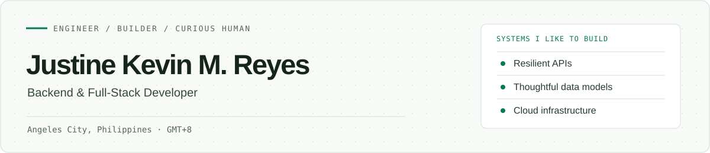

<div align="center">

<picture>
  <source media="(prefers-color-scheme: dark)" srcset="assets/profile-header-dark.svg">
  
</picture>

<br>

<a href="https://github.com/kevv1011/port">Portfolio source</a> · <a href="https://www.linkedin.com/in/justinekevin/">LinkedIn</a> · <a href="mailto:justine.kevin13@gmail.com">Email</a>

</div>

### Hi, I'm Justine Kevin.

I'm a backend and full-stack developer based in **Angeles City, Pampanga, Philippines (GMT+8)**. I enjoy tracing a problem from the interface down to the data model and infrastructure, then building the smallest reliable solution that fits. I'm open to remote and on-site opportunities.

I work on offline-ready applications, APIs, relational databases, and cloud systems. My favorite kind of engineering is the kind users barely notice because it keeps working.

---

### Selected work

| Project | What I built | Stack |
| :--- | :--- | :--- |
| **[TindahanTrack](https://github.com/kevv1011/TinadahanTrack)** | Inventory for neighborhood stores, with an offline `localStorage` fallback, optimistic stock updates, and automated deployment. | React · Express · Neon PostgreSQL · GitHub Actions |
| **[HAUPokemon](https://github.com/kevv1011/HAUPokemon-Monster-App)** | A GPS-enabled mobile experience supported by AWS infrastructure across two regions, VPC Peering, and a MySQL data layer. | React · Capacitor · AWS EC2/RDS · MySQL |
| **Serverless EC2 Dashboard** | A focused interface for instance state checks and start/stop actions through serverless functions. | AWS Lambda · API Gateway · EC2 · JavaScript |

<details>
<summary><strong>A closer look at TindahanTrack's two data paths</strong></summary>

```text
                  Stock and sales interface
                           │
                    Optimistic updates
                           │
                Connected? ──────────────┐
                   │ yes                  │ no
                   ▼                      ▼
            Express REST API        Offline demo mode
                   │                      │
                   ▼                      ▼
            Neon PostgreSQL         localStorage
```

The fallback keeps the demo usable when there is no network. Read the repository for implementation details.

</details>

### Tools I reach for

| Area | Technologies |
| :--- | :--- |
| **Languages** | Python · JavaScript · TypeScript · Dart · PHP · SQL · Bash |
| **Application development** | React · FastAPI · Express · Capacitor |
| **Data** | PostgreSQL · Neon · Supabase · MySQL |
| **Cloud & delivery** | AWS EC2 · Lambda · API Gateway · RDS · VPC Peering · Docker · GitHub Actions · Render |

I also like working through data modeling and command-line projects, including SQL databases and shell applications. You can explore the rest in my [repositories](https://github.com/kevv1011?tab=repositories).

### Currently focused on

- Making everyday workflows resilient when connectivity drops.
- Designing clear boundaries between UI state, APIs, and persistence.
- Learning from the practical trade-offs in cloud and multi-region systems.

### Let's connect

If you're building something where reliability matters, I'd be glad to talk.

**[justine.kevin13@gmail.com](mailto:justine.kevin13@gmail.com)** · **[LinkedIn](https://www.linkedin.com/in/justinekevin/)** · **[GitHub](https://github.com/kevv1011)**

<sub>Built with Markdown, a pair of original SVGs, and a preference for useful details over noisy metrics.</sub>
