<picture>
  <source media="(prefers-color-scheme: dark) and (max-width: 600px)" srcset="assets/editorial/dark/header-mobile.svg">
  <source media="(max-width: 600px)" srcset="assets/editorial/light/header-mobile.svg">
  <source media="(prefers-color-scheme: dark)" srcset="assets/editorial/dark/header.svg">
  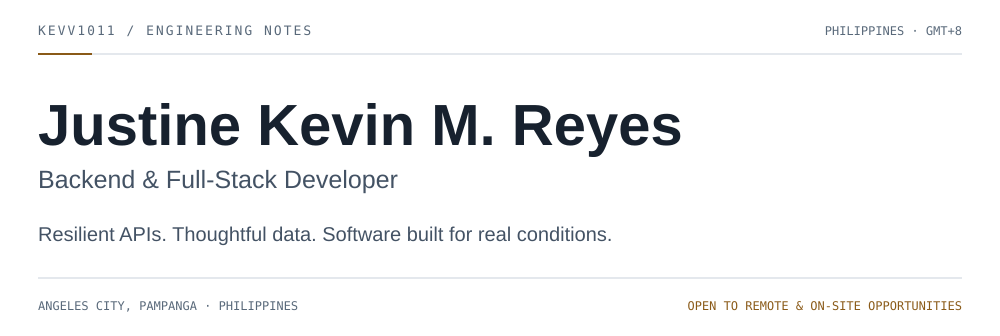
</picture>

  <a href="https://kevv1011.github.io/port/"><picture><source media="(prefers-color-scheme: dark)" srcset="assets/tiles/dark/portfolio.svg"></picture></a>
  <a href="https://www.linkedin.com/in/justinekevin/"><picture><source media="(prefers-color-scheme: dark)" srcset="assets/tiles/dark/linkedin.svg"></picture></a>
  <a href="mailto:justine.kevin13@gmail.com"><picture><source media="(prefers-color-scheme: dark)" srcset="assets/tiles/dark/email.svg"></picture></a>

<picture>
  <source media="(prefers-color-scheme: dark) and (max-width: 600px)" srcset="assets/editorial/dark/about-mobile.svg">
  <source media="(max-width: 600px)" srcset="assets/editorial/light/about-mobile.svg">
  <source media="(prefers-color-scheme: dark)" srcset="assets/editorial/dark/about.svg">
  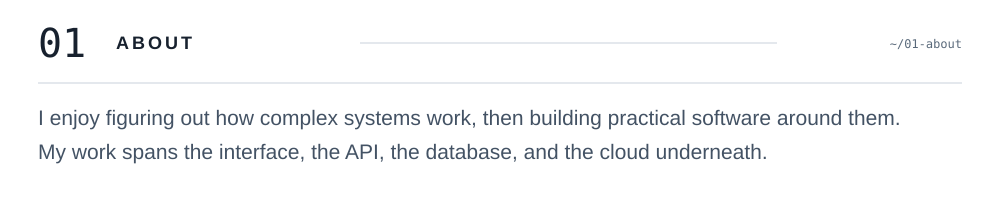
</picture>

  <a href="https://github.com/kevv1011?tab=repositories"><picture><source media="(prefers-color-scheme: dark)" srcset="assets/tiles/dark/focus.svg">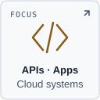</picture></a>
  <a href="https://github.com/kevv1011/TinadahanTrack"><picture><source media="(prefers-color-scheme: dark)" srcset="assets/tiles/dark/approach.svg">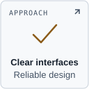</picture></a>
  <a href="https://www.google.com/maps/search/?api=1&amp;query=Angeles+City+Pampanga+Philippines"><picture><source media="(prefers-color-scheme: dark)" srcset="assets/tiles/dark/location.svg"></picture></a>

<picture>
  <source media="(prefers-color-scheme: dark) and (max-width: 600px)" srcset="assets/editorial/dark/map-mobile.svg">
  <source media="(max-width: 600px)" srcset="assets/editorial/light/map-mobile.svg">
  <source media="(prefers-color-scheme: dark)" srcset="assets/editorial/dark/map.svg">
  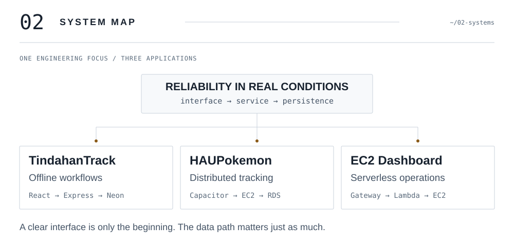
</picture>

<picture>
  <source media="(prefers-color-scheme: dark) and (max-width: 600px)" srcset="assets/editorial/dark/projects-mobile.svg">
  <source media="(max-width: 600px)" srcset="assets/editorial/light/projects-mobile.svg">
  <source media="(prefers-color-scheme: dark)" srcset="assets/editorial/dark/projects.svg">
  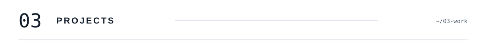
</picture>

<a href="https://github.com/kevv1011/Echelon-Cycling">
<picture>
  <source media="(prefers-color-scheme: dark) and (max-width: 600px)" srcset="assets/editorial/dark/project-echelon-mobile.svg">
  <source media="(max-width: 600px)" srcset="assets/editorial/light/project-echelon-mobile.svg">
  <source media="(prefers-color-scheme: dark)" srcset="assets/editorial/dark/project-echelon.svg">
  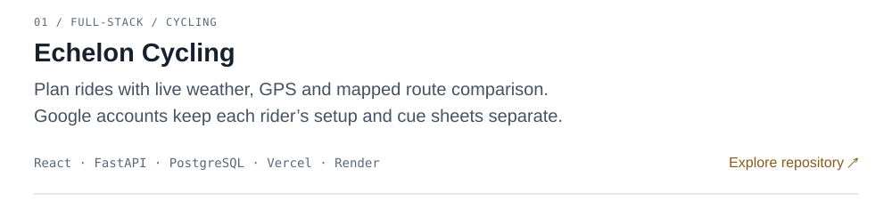
</picture>
</a>

<a href="https://echelon-cycling.vercel.app/">Open Echelon</a> · <a href="https://kevv1011.github.io/Echelon-Cycling/">Try Demo Mode without an account</a>

<a href="https://github.com/kevv1011/TinadahanTrack">
<picture>
  <source media="(prefers-color-scheme: dark) and (max-width: 600px)" srcset="assets/editorial/dark/project-inventory-mobile.svg">
  <source media="(max-width: 600px)" srcset="assets/editorial/light/project-inventory-mobile.svg">
  <source media="(prefers-color-scheme: dark)" srcset="assets/editorial/dark/project-inventory.svg">
  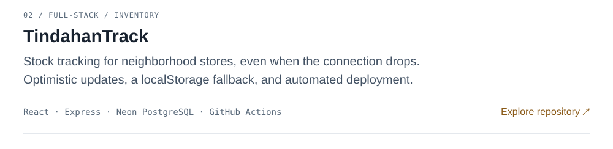
</picture>
</a>

<a href="https://github.com/kevv1011/HAUPokemon-Monster-App">
<picture>
  <source media="(prefers-color-scheme: dark) and (max-width: 600px)" srcset="assets/editorial/dark/project-tracking-mobile.svg">
  <source media="(max-width: 600px)" srcset="assets/editorial/light/project-tracking-mobile.svg">
  <source media="(prefers-color-scheme: dark)" srcset="assets/editorial/dark/project-tracking.svg">
  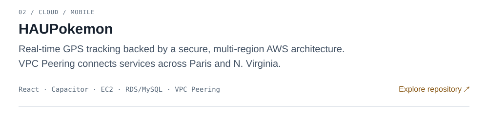
</picture>
</a>

<a href="mailto:justine.kevin13@gmail.com?subject=Serverless%20EC2%20Dashboard">
<picture>
  <source media="(prefers-color-scheme: dark) and (max-width: 600px)" srcset="assets/editorial/dark/project-serverless-mobile.svg">
  <source media="(max-width: 600px)" srcset="assets/editorial/light/project-serverless-mobile.svg">
  <source media="(prefers-color-scheme: dark)" srcset="assets/editorial/dark/project-serverless.svg">
  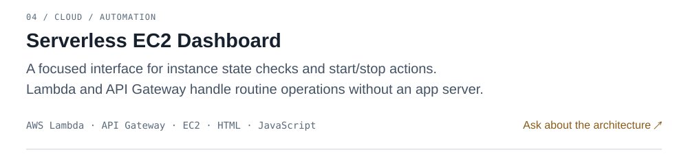
</picture>
</a>

<a href="https://github.com/kevv1011?tab=repositories">
<picture>
  <source media="(prefers-color-scheme: dark) and (max-width: 600px)" srcset="assets/editorial/dark/project-data-mobile.svg">
  <source media="(max-width: 600px)" srcset="assets/editorial/light/project-data-mobile.svg">
  <source media="(prefers-color-scheme: dark)" srcset="assets/editorial/dark/project-data.svg">
  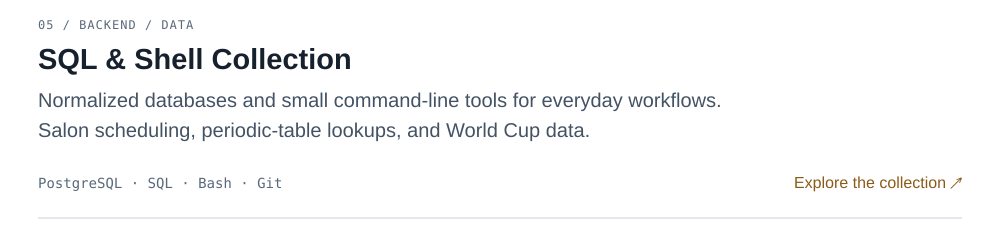
</picture>
</a>

<picture>
  <source media="(prefers-color-scheme: dark) and (max-width: 600px)" srcset="assets/editorial/dark/telemetry-mobile.svg">
  <source media="(max-width: 600px)" srcset="assets/editorial/light/telemetry-mobile.svg">
  <source media="(prefers-color-scheme: dark)" srcset="assets/editorial/dark/telemetry.svg">
  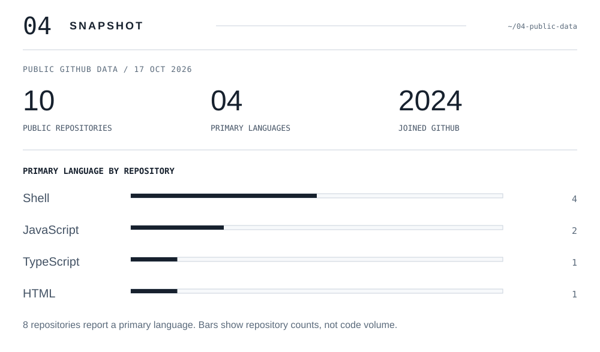
</picture>

<picture>
  <source media="(prefers-color-scheme: dark) and (max-width: 600px)" srcset="assets/editorial/dark/journey-mobile.svg">
  <source media="(max-width: 600px)" srcset="assets/editorial/light/journey-mobile.svg">
  <source media="(prefers-color-scheme: dark)" srcset="assets/editorial/dark/journey.svg">
  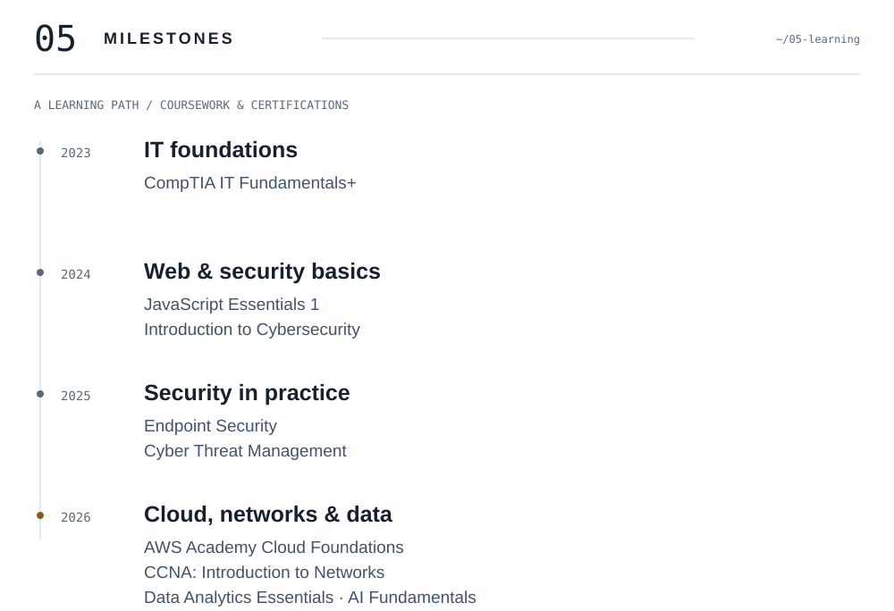
</picture>

<picture>
  <source media="(prefers-color-scheme: dark) and (max-width: 600px)" srcset="assets/editorial/dark/stack-mobile.svg">
  <source media="(max-width: 600px)" srcset="assets/editorial/light/stack-mobile.svg">
  <source media="(prefers-color-scheme: dark)" srcset="assets/editorial/dark/stack.svg">
  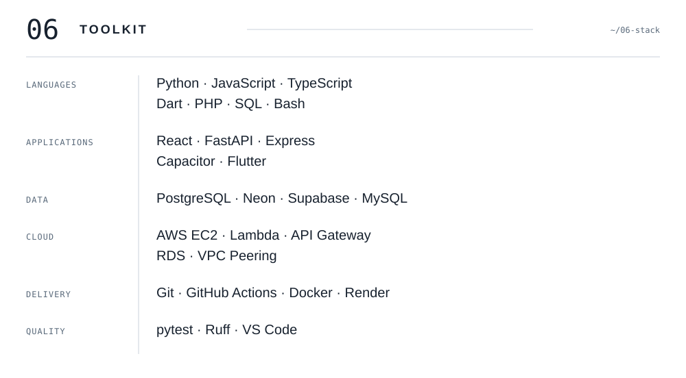
</picture>

<h4>Languages</h4>

  <a href="https://www.python.org/"><picture><source media="(prefers-color-scheme: dark)" srcset="assets/tiles/dark/python.svg">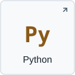</picture></a>
  <a href="https://developer.mozilla.org/en-US/docs/Web/JavaScript"><picture><source media="(prefers-color-scheme: dark)" srcset="assets/tiles/dark/javascript.svg">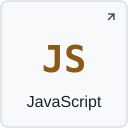</picture></a>
  <a href="https://www.typescriptlang.org/"><picture><source media="(prefers-color-scheme: dark)" srcset="assets/tiles/dark/typescript.svg">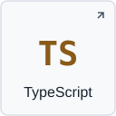</picture></a>
  <a href="https://dart.dev/"><picture><source media="(prefers-color-scheme: dark)" srcset="assets/tiles/dark/dart.svg">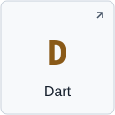</picture></a>
  <a href="https://www.php.net/"><picture><source media="(prefers-color-scheme: dark)" srcset="assets/tiles/dark/php.svg"></picture></a>
  <a href="https://www.postgresql.org/docs/current/sql.html"><picture><source media="(prefers-color-scheme: dark)" srcset="assets/tiles/dark/sql.svg"></picture></a>
  <a href="https://www.gnu.org/software/bash/"><picture><source media="(prefers-color-scheme: dark)" srcset="assets/tiles/dark/bash.svg">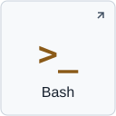</picture></a>

<h4>Applications</h4>

  <a href="https://react.dev/"><picture><source media="(prefers-color-scheme: dark)" srcset="assets/tiles/dark/react.svg">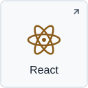</picture></a>
  <a href="https://fastapi.tiangolo.com/"><picture><source media="(prefers-color-scheme: dark)" srcset="assets/tiles/dark/fastapi.svg">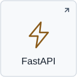</picture></a>
  <a href="https://expressjs.com/"><picture><source media="(prefers-color-scheme: dark)" srcset="assets/tiles/dark/express.svg"></picture></a>
  <a href="https://capacitorjs.com/"><picture><source media="(prefers-color-scheme: dark)" srcset="assets/tiles/dark/capacitor.svg">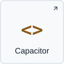</picture></a>
  <a href="https://flutter.dev/"><picture><source media="(prefers-color-scheme: dark)" srcset="assets/tiles/dark/flutter.svg">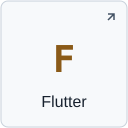</picture></a>

<h4>Data</h4>

  <a href="https://www.postgresql.org/"><picture><source media="(prefers-color-scheme: dark)" srcset="assets/tiles/dark/postgresql.svg"></picture></a>
  <a href="https://neon.com/"><picture><source media="(prefers-color-scheme: dark)" srcset="assets/tiles/dark/neon.svg">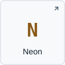</picture></a>
  <a href="https://supabase.com/"><picture><source media="(prefers-color-scheme: dark)" srcset="assets/tiles/dark/supabase.svg">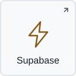</picture></a>
  <a href="https://www.mysql.com/"><picture><source media="(prefers-color-scheme: dark)" srcset="assets/tiles/dark/mysql.svg"></picture></a>

<h4>Cloud</h4>

  <a href="https://aws.amazon.com/ec2/"><picture><source media="(prefers-color-scheme: dark)" srcset="assets/tiles/dark/ec2.svg">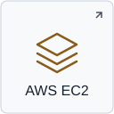</picture></a>
  <a href="https://aws.amazon.com/lambda/"><picture><source media="(prefers-color-scheme: dark)" srcset="assets/tiles/dark/lambda.svg">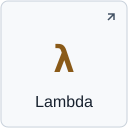</picture></a>
  <a href="https://aws.amazon.com/api-gateway/"><picture><source media="(prefers-color-scheme: dark)" srcset="assets/tiles/dark/gateway.svg">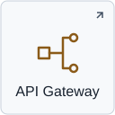</picture></a>
  <a href="https://aws.amazon.com/rds/"><picture><source media="(prefers-color-scheme: dark)" srcset="assets/tiles/dark/rds.svg">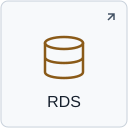</picture></a>
  <a href="https://docs.aws.amazon.com/vpc/latest/peering/what-is-vpc-peering.html"><picture><source media="(prefers-color-scheme: dark)" srcset="assets/tiles/dark/vpc.svg">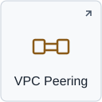</picture></a>

<h4>Delivery</h4>

  <a href="https://git-scm.com/"><picture><source media="(prefers-color-scheme: dark)" srcset="assets/tiles/dark/git.svg">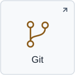</picture></a>
  <a href="https://github.com/features/actions"><picture><source media="(prefers-color-scheme: dark)" srcset="assets/tiles/dark/actions.svg"></picture></a>
  <a href="https://www.docker.com/"><picture><source media="(prefers-color-scheme: dark)" srcset="assets/tiles/dark/docker.svg">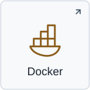</picture></a>
  <a href="https://render.com/"><picture><source media="(prefers-color-scheme: dark)" srcset="assets/tiles/dark/render.svg">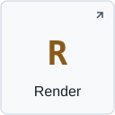</picture></a>
  <a href="https://vercel.com/"><picture><source media="(prefers-color-scheme: dark)" srcset="assets/tiles/dark/vercel.svg">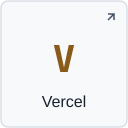</picture></a>

<h4>Quality</h4>

  <a href="https://docs.pytest.org/"><picture><source media="(prefers-color-scheme: dark)" srcset="assets/tiles/dark/pytest.svg">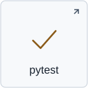</picture></a>
  <a href="https://docs.astral.sh/ruff/"><picture><source media="(prefers-color-scheme: dark)" srcset="assets/tiles/dark/ruff.svg">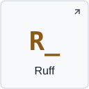</picture></a>
  <a href="https://code.visualstudio.com/"><picture><source media="(prefers-color-scheme: dark)" srcset="assets/tiles/dark/vscode.svg">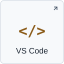</picture></a>

<a href="mailto:justine.kevin13@gmail.com">
<picture>
  <source media="(prefers-color-scheme: dark) and (max-width: 600px)" srcset="assets/editorial/dark/footer-mobile.svg">
  <source media="(max-width: 600px)" srcset="assets/editorial/light/footer-mobile.svg">
  <source media="(prefers-color-scheme: dark)" srcset="assets/editorial/dark/footer.svg">
  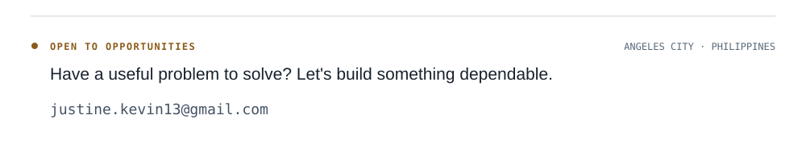
</picture>
</a>

Text version, project links &amp; data notes

## Justine Kevin M. Reyes

Backend & Full-Stack Developer based in Angeles City, Pampanga, Philippines (GMT+8). Open to remote and on-site opportunities. I enjoy figuring out how complex systems work and building practical software across interfaces, APIs, relational databases, and cloud infrastructure.

### Selected work

- [Echelon Cycling](https://github.com/kevv1011/Echelon-Cycling): mobile-first ride planning with live weather, GPS recording, mapped route comparison, and separate rider accounts through Google sign-in. React, FastAPI, PostgreSQL, Vercel, Render. [Open the live app](https://echelon-cycling.vercel.app/) or [try Demo Mode](https://kevv1011.github.io/Echelon-Cycling/) without an account. Route suggestions use mapped road tags and are not a safety guarantee.
- [TindahanTrack](https://github.com/kevv1011/TinadahanTrack): inventory workflows with optimistic updates, a localStorage fallback, and automated deployment. React, Express, Neon PostgreSQL, GitHub Actions.
- [HAUPokemon](https://github.com/kevv1011/HAUPokemon-Monster-App): GPS-enabled mobile tracking supported by AWS infrastructure across Paris and N. Virginia. React, Capacitor, EC2, RDS/MySQL, VPC Peering.
- Serverless EC2 Dashboard: instance state checks and start/stop actions with Lambda, API Gateway, EC2, and JavaScript. [Ask about the architecture](mailto:justine.kevin13@gmail.com?subject=Serverless%20EC2%20Dashboard).
- SQL & Shell Collection: [Salon Scheduler](https://github.com/kevv1011/Build-a-Salon-Appointment-Scheduler), [Periodic Table](https://github.com/kevv1011/Build-a-Periodic-Table-Database), [Number Guessing Game](https://github.com/kevv1011/Build-a-Number-Guessing-Game), and [World Cup database](https://github.com/kevv1011/FCC-IMAN-WorldCup).

### Toolkit

Python, JavaScript, TypeScript, Dart, PHP, SQL, Bash, React, FastAPI, Express, Capacitor, Flutter, PostgreSQL, Neon, Supabase, MySQL, AWS EC2, Lambda, API Gateway, RDS, VPC Peering, Git, GitHub Actions, Docker, Render, Vercel, pytest, Ruff, and VS Code.

### Learning milestones

- 2023: CompTIA IT Fundamentals+.
- 2024: JavaScript Essentials 1; Introduction to Cybersecurity.
- 2025: Endpoint Security; Cyber Threat Management.
- 2026: AWS Academy Cloud Foundations; CCNA: Introduction to Networks; Data Analytics Essentials; AI Fundamentals with IBM SkillsBuild.

Credential details are owner-supplied. Public repository statistics are a static snapshot from [GitHub's public API](https://api.github.com/users/kevv1011/repos?per_page=100) on 21 October 2026. Language bars count repositories by primary language, not code volume. Two of eleven repositories report no primary language. GitHub's native contribution graph appears below this README.

[View portfolio](https://kevv1011.github.io/port/) · [Portfolio source](https://github.com/kevv1011/port) · [LinkedIn](https://www.linkedin.com/in/justinekevin/) · [Email](mailto:justine.kevin13@gmail.com)

